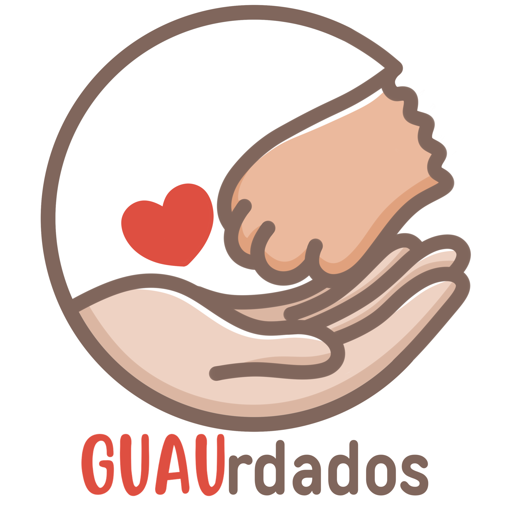
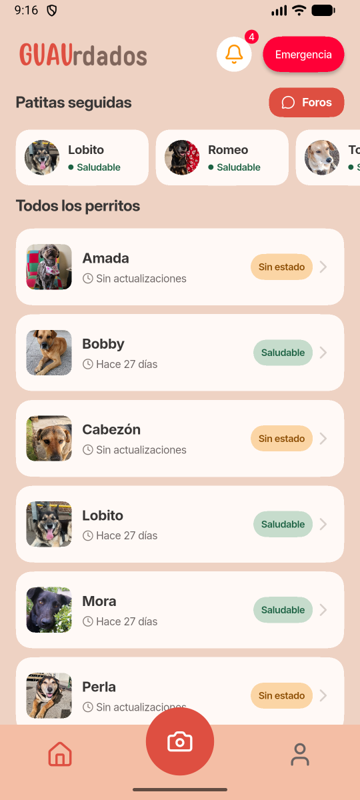
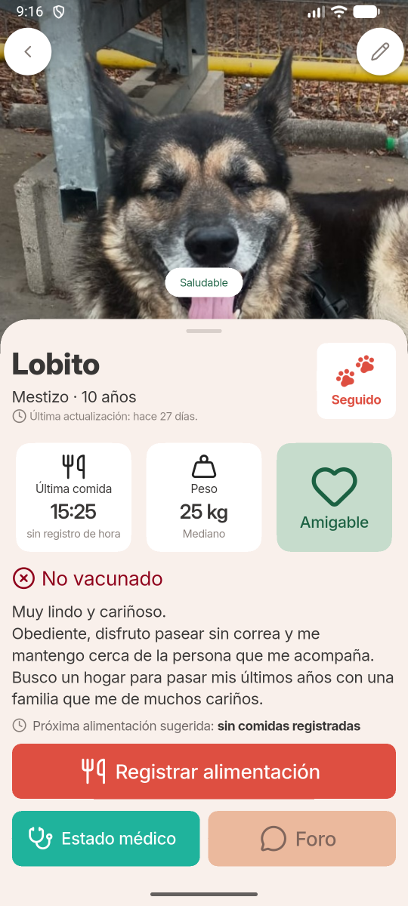
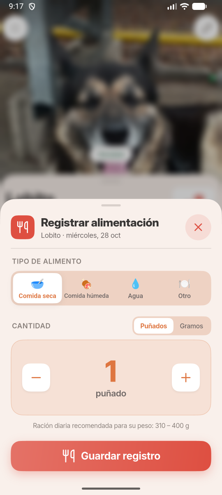
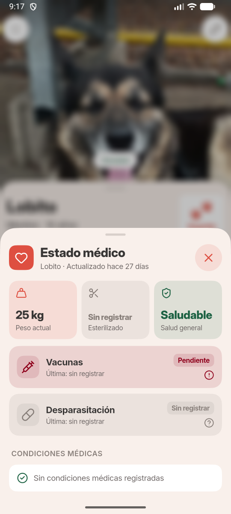
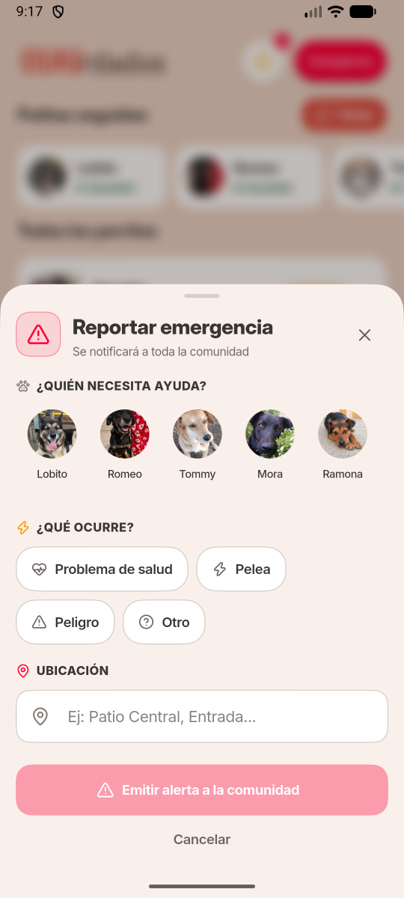
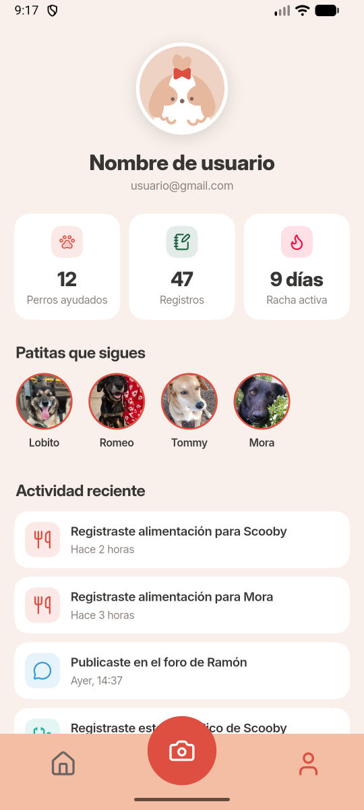
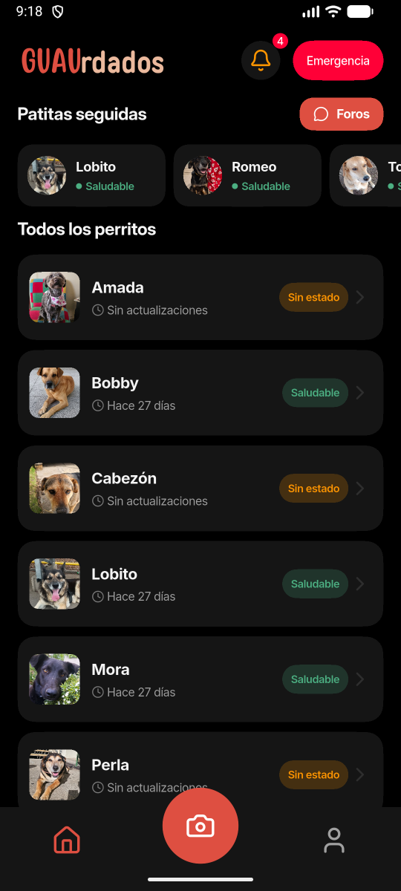
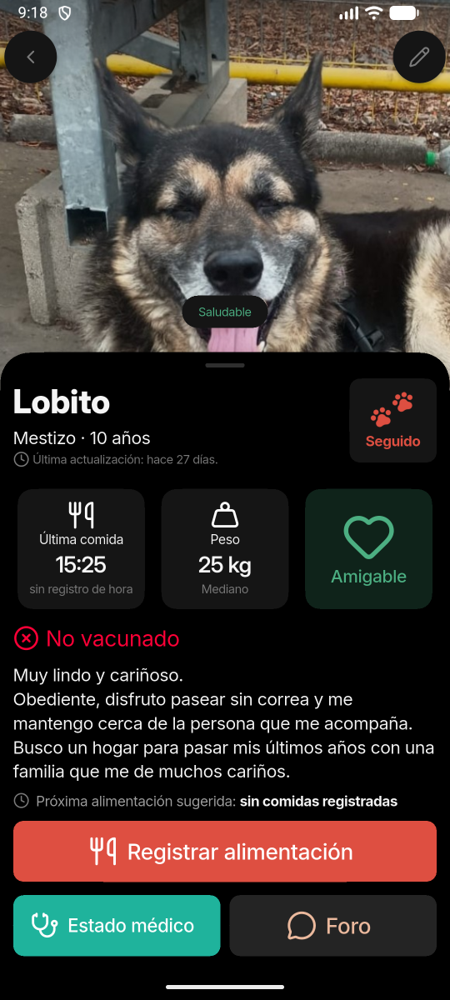

# GUAUrdados

Amor y protección en la palma de tu mano.

**[Descargar la app para Android](https://patitas-unidas.github.io/GUAUrdados-web/)**

 

GUAUrdados es una iniciativa dedicada a la identificación, la coordinación de ayuda comunitaria y el cuidado de perritos en situación de calle.

Muchos de ellos son cuidados por su comunidad, pero sin coordinarse: a veces comen varias veces el mismo día, los cuidados médicos se repiten y su historial queda en papel. GUAUrdados reúne en una sola app la ficha de cada perrito, lo que necesita y a quién avisar si algo pasa, para darle una patita a quienes más lo necesitan.

<table>
  <tr>
    <td></td>
    <td></td>
    <td></td>
  </tr>
  <tr>
    <td></td>
    <td></td>
    <td></td>
  </tr>
</table>

También tiene modo oscuro

<table>
  <tr>
    <td></td>
    <td></td>
  </tr>
</table>

## Qué se puede hacer

- Ver a todos los perritos de tu comunidad, con su estado (saludable, por revisar o urgente), y seguir a tus favoritos.
- Revisar el perfil de cada uno: carácter, peso, vacunas, estado médico y carnet veterinario.
- Registrar qué y cuánto comió o tomó agua; la app sugiere cuándo le toca comer para que no coma de más.
- Reportar una emergencia de uno o varios perritos. Queda fijada en el foro hasta que quien la reportó cuenta cómo terminó.
- Recibir en la campana las novedades de los perritos que sigues y una alerta si llevan mucho tiempo sin comer o sin agua.
- Identificar a un perrito con una foto *(en desarrollo)* y avisar a GUAU si aparece uno que no está registrado.
- Conversar en el foro de cada perrito: publicar, reaccionar y comentar.
- Ganar insignias por ayudar.
- Saber qué perritos ya encontraron un hogar, y contactar a GUAU para adoptar o donar.

## Equipo

**Patitas Unidas**, Grupo 2 de Proyecto de Software, Universidad Técnica Federico Santa María, sede Viña del Mar.

| | |
|---|---|
| Aylin Rojas | Product Owner y Arquitecta de Software |
| Valentina Muñoz | Scrum Master y Arquitecta de IA |
| Mishas Silva | Diseñador UI/UX |
| Alejandra Zamora | Desarrolladora Frontend |
| Frano Cerda | Desarrollador Backend |

En colaboración con **GUAU**, Grupo Universitario de Ayuda Canina.

 

Usa la tipografía [Inter](https://rsms.me/inter/) (OFL 1.1) y los íconos de [Lucide](https://lucide.dev/) (ISC) y [Phosphor](https://phosphoricons.com/) (MIT).

 
🐾

