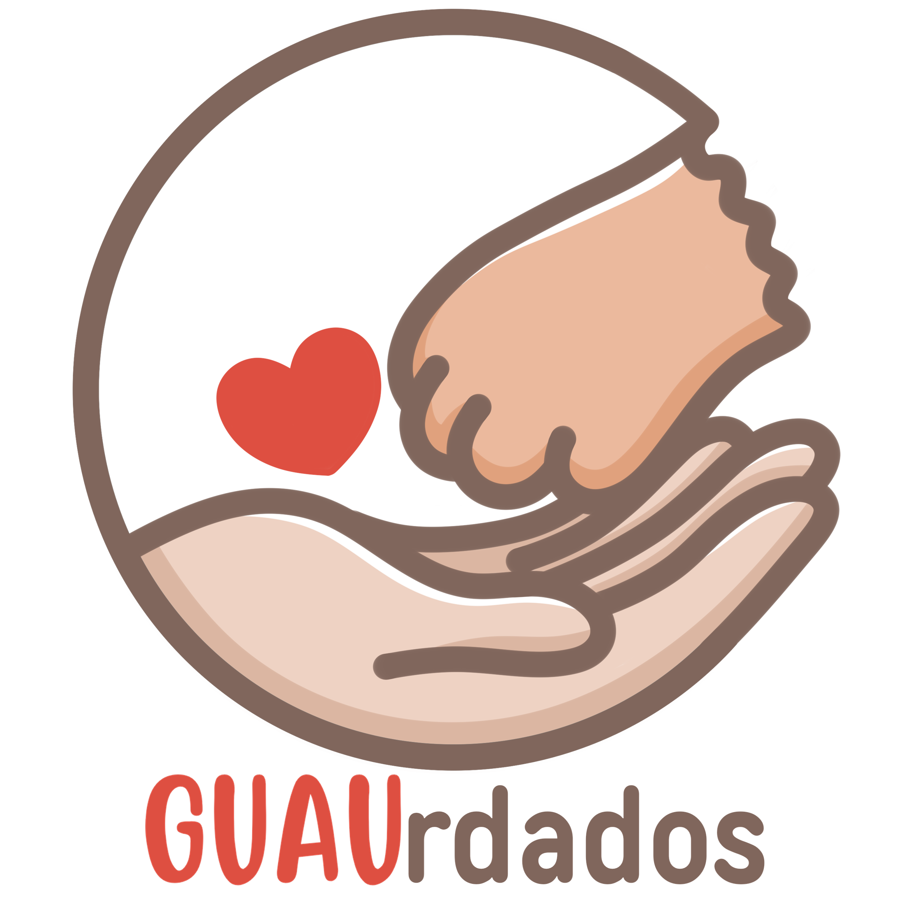
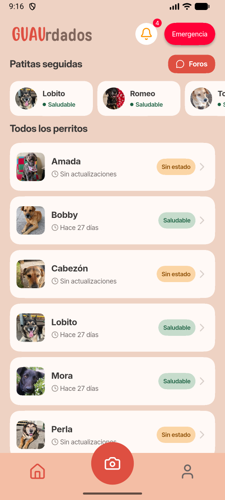
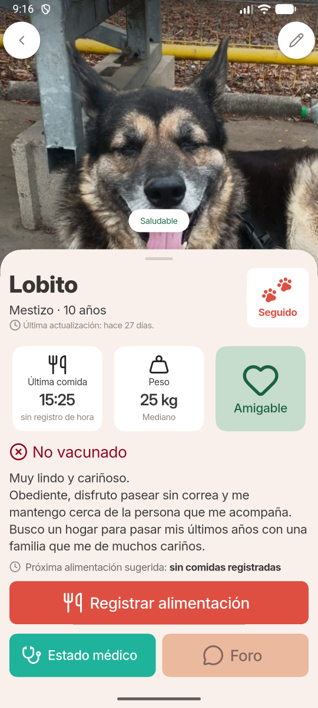
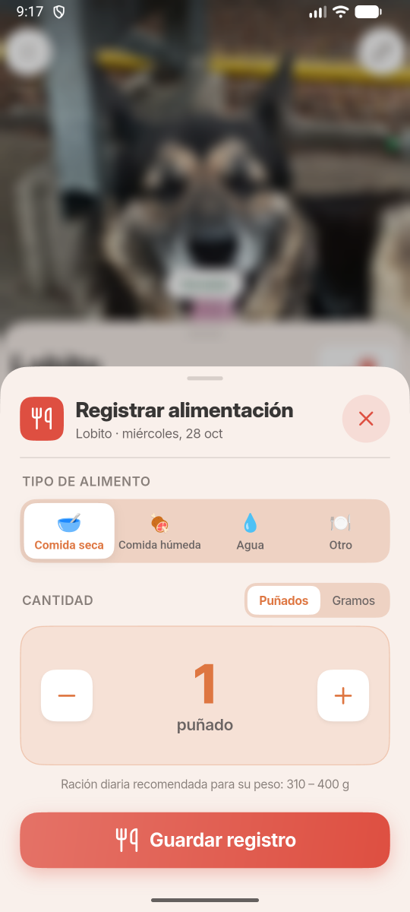
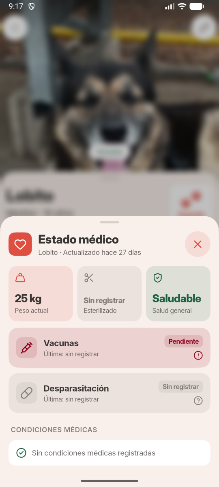
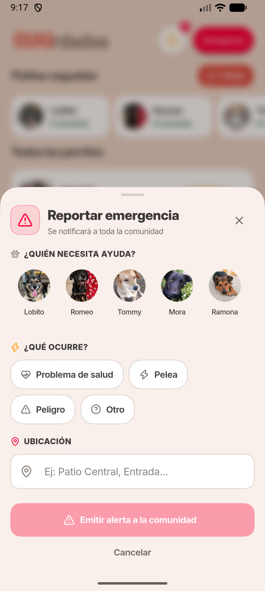
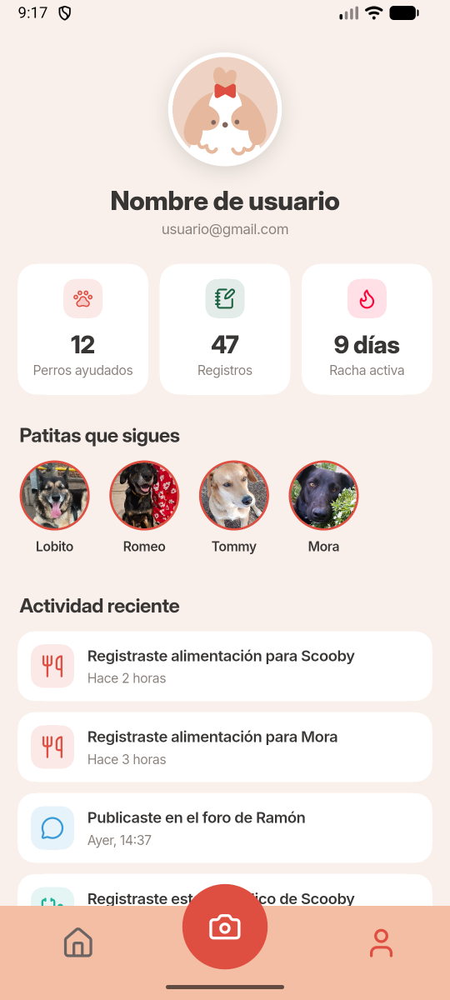
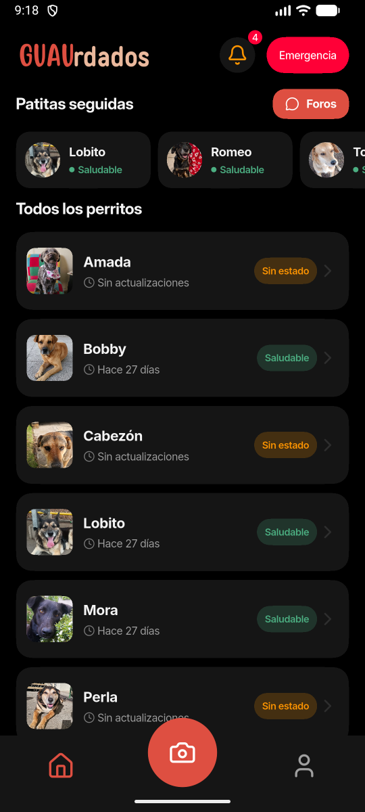
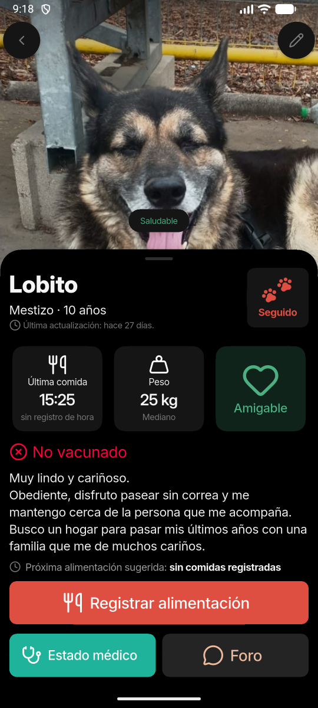

# GUAUrdados

Cuidamos juntos a los perros comunitarios de la USM, sede Viña del Mar.

**[Descargar la app para Android](https://patitas-unidas.github.io/GUAUrdados-web/)**

 

En la sede viven perros en situación de calle que la comunidad cuida todos los días, pero sin coordinarse: a veces comen varias veces el mismo día, los cuidados médicos se repiten, no siempre se sabe quién es quién y su historial queda en papel.

GUAUrdados reúne en una sola app la ficha de cada perrito, lo que necesita y a quién avisar si algo pasa.

<table>
  <tr>
    <td></td>
    <td></td>
    <td></td>
  </tr>
  <tr>
    <td></td>
    <td></td>
    <td></td>
  </tr>
</table>

También tiene modo oscuro

<table>
  <tr>
    <td></td>
    <td></td>
  </tr>
</table>

## Qué se puede hacer

- Ver a todos los perritos de la sede y seguir a tus favoritos.
- Revisar el perfil de cada uno: carácter, peso, vacunas y estado médico.
- Registrar cuándo y cuánto comió *(en desarrollo)*.
- Reportar una emergencia y avisar a la comunidad.
- Recibir novedades de los perritos que sigues.
- Identificar a un perrito con una foto *(en desarrollo)*.
- Conversar en el foro de cada perrito *(en desarrollo)*.

## Equipo

**Patitas Unidas**, Grupo 2 de Proyecto de Software, Universidad Técnica Federico Santa María, sede Viña del Mar.

| | |
|---|---|
| Aylin Rojas | Product Owner y Arquitecta de Software |
| Valentina Muñoz | Scrum Master y Arquitecta de IA |
| Mishas Silva | Diseñador UI/UX |
| Alejandra Zamora | Desarrolladora Frontend |
| Frano Cerda | Desarrollador Backend |

En colaboración con **GUAU**, Grupo Universitario de Ayuda Canina.

 

Usa la tipografía [Inter](https://rsms.me/inter/) (OFL 1.1) y los íconos de [Lucide](https://lucide.dev/) (ISC) y [Phosphor](https://phosphoricons.com/) (MIT).

 
🐾

